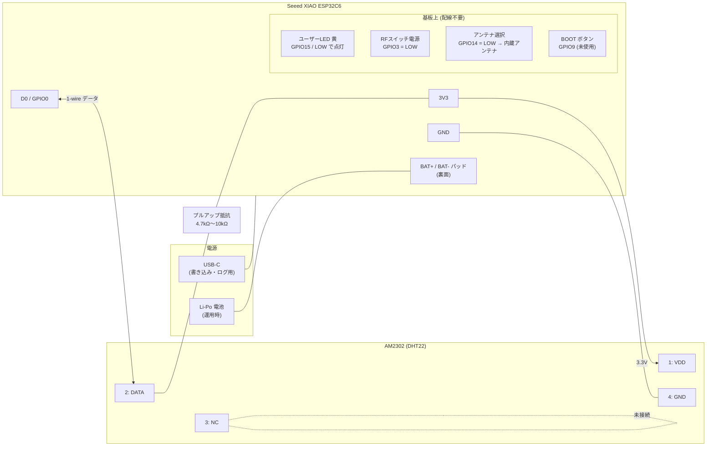

# ハードウェア配線

ファームウェアのピン定義: [PinAssign.h](../main/src/frameworksanddrivers/PinAssign.h)

## 接続表

| XIAO ESP32C6 | AM2302 | 備考 |
|---|---|---|
| 3V3 | 1: VDD | AM2302 は 3.3V〜5.5V で動く |
| D0（GPIO0） | 2: DATA | 3V3 との間に 4.7kΩ〜10kΩ のプルアップ抵抗を入れる |
| — | 3: NC | 何もつながない |
| GND | 4: GND | |

## 補足

- **プルアップ:** 内蔵プルアップも有効にしているが弱いので、外付け抵抗を推奨。3ピンの基板付きモジュールはプルアップ抵抗が載っていることが多いので、その場合は不要。
- **D0 を選んだ理由:** GPIO0〜7 は Light Sleep 中も扱える LP IO。将来ボタンで起こすようにするなら、ボタンもこの範囲（D0〜D2 / GPIO0〜2）のピンにする。
- **電池:** Li-Po は裏面の BAT+ / BAT- パッドにつなぐ。USB を挿している間は Light Sleep しない設定（`CONFIG_USJ_NO_AUTO_LS_ON_CONNECTION=y`）なので、消費電流は電池だけで動かして測る。
- **基板上のピン:** LED（GPIO15）と RF スイッチ（GPIO3 / GPIO14）は基板上で配線済みなので外部配線は不要。外部アンテナを使うときは [PinAssign.h](../main/src/frameworksanddrivers/PinAssign.h) と [XiaoBoard.hpp](../main/src/frameworksanddrivers/XiaoBoard.hpp) で GPIO14 を HIGH にする。
